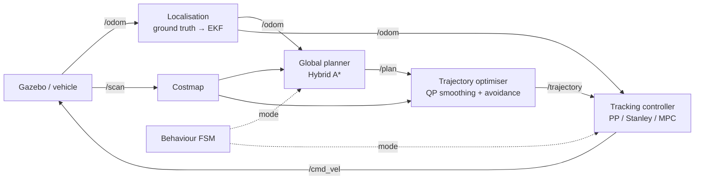

# pnc-stack — Design Document

Status: v0.2 (Phase 1 started). Owner: Hu Zhiguo. Last updated: 2026-11-06.

## 1. Goal

Build a complete planning-and-control stack for an Ackermann-steered vehicle on
ROS 2 Jazzy, written from scratch where it matters (planning, trajectory
optimisation, control) and benchmarked quantitatively against Nav2 baselines.

Success means three things:

1. The vehicle completes every scenario in §6 in Gazebo without collision.
2. Each self-written module is measured against a named baseline with the
   metrics in §6, and the results are reproducible from one command.
3. The code base meets ordinary industry standards: unit tests, CI, consistent
   formatting, documented interfaces.

### Non-goals

- Perception. Obstacles come from the simulator's ground truth or a simulated
  laser scan into a costmap; no learned detection.
- Localisation research. Phase 1 uses simulator ground truth; Phase 3 swaps in
  `robot_localization` (EKF) without changing downstream interfaces.
- High-speed dynamics. Speeds stay below 3 m/s, so the kinematic bicycle model
  is adequate for prediction.

## 2. Platform

| Item | Choice | Reason |
|---|---|---|
| OS | Ubuntu 24.04 | Matches ROS 2 Jazzy Tier 1 support |
| ROS | ROS 2 Jazzy | LTS release |
| Simulator | Gazebo Harmonic via `ros_gz` | Paired with Jazzy; has an Ackermann steering system plugin |
| Vehicle | 1:10 Ackermann car, wheelbase 0.33 m | Close to common lab platforms, so the stack can move to hardware |
| Language | C++17 (algorithms, nodes), Python (launch, analysis) | |
| Solvers | OSQP (QP smoothing), acados or CasADi (MPC) | Real-time capable, widely used in industry |

## 3. Architecture

### Layering rule

Every algorithm lives in `pnc_core`, a plain CMake library with **no ROS
dependency**. ROS packages only convert messages, run timers and handle
parameters. Consequences:

- Algorithms are unit-tested with GoogleTest in milliseconds, without starting
  any ROS process.
- The same library runs in the offline harness (`track_sim`), in the ROS node,
  and later in batch evaluation scripts.
- Controllers share one interface (`pnc_core::ControllerInterface`), so the node
  selects one by the parameter `controller.type`; adding a controller does not
  touch the node's message handling.

### Packages

| Package | Build type | Contents |
|---|---|---|
| `pnc_core` | cmake | Types, kinematic bicycle model, path utilities, controllers; unit tests; `track_sim` tool |
| `pnc_control` | ament_cmake | `tracking_controller` and `reference_path` nodes (also loadable as components) |
| `pnc_sim` | ament_cmake | Gazebo Harmonic car model and world, ros_gz bridge config, `sim.launch.py` |
| `pnc_planning` | ament_cmake | *Phase 2*: Hybrid A* global planner node, QP trajectory optimiser |
| `pnc_bringup` | ament_cmake | Launch files and parameter YAML |
| `pnc_eval` | ament_python | *Phase 3*: scenario runner, rosbag metrics, plots |

Custom messages (`pnc_msgs`) are added only when a standard message no longer
fits, e.g. a trajectory with time and curvature per point in Phase 2.

## 4. Interfaces

### Topics

| Topic | Type | Producer → Consumer | QoS | Notes |
|---|---|---|---|---|
| `/odom` | `nav_msgs/Odometry` | sim / EKF → planner, controller | sensor data | Pose of the rear-axle centre |
| `/plan` | `nav_msgs/Path` | planner → controller | reliable, transient local | Latched, so late joiners get the last plan |
| `/cmd_vel` | `geometry_msgs/Twist` | controller → sim | reliable, depth 10 | `linear.x` = speed, `angular.z` = yaw rate |
| `/tracking_controller/cross_track_error` | `std_msgs/Float64` | controller → eval | reliable | Signed, left positive |

Steering angle is converted to yaw rate with ω = v·tan(δ)/L because the Gazebo
Ackermann plugin accepts a Twist. A real car whose driver takes steering angle
directly would use a different output adapter; the controller is unchanged.

### Frames

`map → odom → base_link`. In Phase 1, with ground-truth odometry, `map` and
`odom` coincide and the controller works in `odom`. All poses are at the rear
axle centre, the reference point of the kinematic bicycle model.

### Safety behaviour of the controller node

- No path, no odometry, or goal reached → publish zero Twist every cycle.
- Odometry older than `odom_timeout_s` → stop and warn.
- Goal is reached only when progress along the path is near the end **and**
  the vehicle is within `goal_tolerance`. Progress is tracked with a
  forward-only windowed search, so a closed path (start = end) does not stop
  the vehicle at the start.
- A repeated delivery of the same latched plan (same stamp and size) is
  ignored, so it cannot reset progress mid-run.

## 5. Algorithms and planned work

| Module | Baseline (compare against) | Own implementation | Phase |
|---|---|---|---|
| Path tracking | Nav2 Regulated Pure Pursuit, MPPI | Pure Pursuit ✔, Stanley, LQR, MPC | 0–1 |
| Global planning | Nav2 Smac Hybrid-A* | Hybrid A* with Reeds–Shepp analytic expansion | 2 |
| Trajectory optimisation | none (raw Hybrid A* path) | Piecewise-jerk QP with corridor constraints (OSQP) | 2 |
| Dynamic obstacles | Nav2 default | Speed planning on S–T graph | 3 |
| Behaviour | — | FSM: cruise, avoid, park, stop | 3 |

## 6. Evaluation

### Scenarios

| ID | Scenario | What it stresses |
|---|---|---|
| S1 | Straight line with 0.5 m initial offset | Convergence, overshoot |
| S2 | Circle, R = 3 m | Steady-state curve error |
| S3 | Narrow passage (0.3 m clearance each side) | Planner precision, controller error |
| S4 | U-turn | Curvature near steering limit |
| S5 | Static obstacles on the route | Replanning, trajectory smoothness |
| S6 | Crossing pedestrian (moving obstacle) | Speed planning, reaction time |
| S7 | Reverse parallel parking | Reeds–Shepp, direction switches |

### Metrics

- Cross-track error: RMS and maximum, after a 5 s settling window
- Heading error: RMS
- Success rate over N = 20 runs with randomised start pose
- Compute time per control cycle: mean and 99th percentile
- Smoothness: RMS jerk and RMS steering rate
- Time to goal

Each run is recorded as a rosbag; `pnc_eval` computes the metrics from the bag,
so every number in the results table can be regenerated.

### Current baseline (Phase 0, offline kinematic model)

Measured with `track_sim` (RK4 kinematic bicycle, 50 Hz, Pure Pursuit with
default parameters). These validate the implementation; Gazebo numbers will
replace them in Phase 1.

| Scenario | RMS CTE | Max CTE | Max compute / cycle |
|---|---|---|---|
| S1 straight, 0.5 m offset | 0.0014 m | 0.0108 m | < 0.2 ms |
| S2 circle, R = 3 m, 1 m/s | 0.0064 m | 0.0183 m | < 0.1 ms |

End-to-end check through ROS 2 (both nodes, unicycle stand-in simulator, one
lap of S2): max CTE after settling 0.033 m, stops within goal tolerance.

### Gazebo (Phase 1)

Pure Pursuit, 1 m/s, CTE scored after the first 5 s. Every run reaches the
end of its path without touching a wall or cone.

| Scenario | RMS CTE | Max CTE | Notes |
|---|---|---|---|
| S1 straight, 0.5 m offset | 0.0035 m | 0.0150 m | |
| S2 circle, R = 3 m | 0.0057 m | 0.0282 m | One lap |
| S3 narrow passage | 0.028 m | 0.075 m | Error peaks at the S-bend curvature jumps |
| S4 U-turn, R = 1.2 m | 0.079 m | 0.134 m | Cuts the inside of the turn |
| S5 cone slalom | 0.074 m | 0.117 m | |
| S7 parallel parking | — | — | Forward approach only until Reeds–Shepp (Phase 2) |

The corner cutting in S3–S5 is the expected Pure Pursuit behaviour: the
lookahead point (1.3 m at 1 m/s) is already on the next arc before the car
reaches it. These are the baseline numbers for Stanley and MPC.

### Scenario worlds

A scenario's reference path is written once, as lines and arcs, in
`pnc_bringup/config/scenarios/<name>.yaml` (`shape: segments`, parsed by
`pnc_core::parseSegment` and sampled by `pnc_core::makeSegmentPath`).
`tools/make_scenario_worlds.py` reads the same file and places the painted
centre line, walls and cones relative to the path, so the world and the path
cannot drift apart. Clearances: S3 0.3 m each side of the car, S4 0.55 m,
S5 0.3 m to each cone. CI runs every scenario headless with
`tools/sim_smoke_test.py`, which fails on a collision (the car stops short of
the path end) or a cross-track error above about half the clearance.

### Simulation model

`pnc_sim` defines the car in SDF rather than adapting an example, so its
geometry matches `VehicleParams` exactly: wheelbase 0.33 m, track 0.25 m,
wheel radius 0.05 m, steering limit 0.45 rad, rear-wheel drive. The model frame
is the rear-axle centre. Gazebo's `AckermannSteering` system turns the Twist
into wheel speeds and steering angles; `OdometryPublisher` publishes ground
truth for that frame, bridged to `/odom`. The worlds have no sensors or shadows
so they run on an integrated GPU, and with `headless:=true` in CI.

The controller node integrates its own previous speed command rather than the
measured speed. With the measured speed, a drive that delivers about 1 % less
than commanded left the car at 0.83 m/s instead of 1.0 m/s; integrating the
command removes that steady-state error.

## 7. Roadmap

- **Phase 0 (Nov 2026 – Jan 2027)** — Environment, ROS 2 C++ fundamentals,
  repository skeleton, CI, Pure Pursuit with tests. ✔ skeleton done
- **Phase 1 (Feb – Mar 2027)** — Gazebo Ackermann model and world; Nav2
  baseline running; Stanley and MPC controllers; first S1–S4 results.
- **Phase 2 (Apr – May 2027)** — Hybrid A*; QP trajectory optimisation;
  `pnc_msgs/Trajectory`; S3–S5 and S7.
- **Phase 3 (Jun – Jul 2027)** — Moving obstacles, behaviour FSM, EKF
  localisation, full evaluation, demo video; hardware if a platform is
  available.

## 8. Open questions

- MPC solver: acados (faster, more setup) vs CasADi + IPOPT (slower, easier).
  Start with CasADi for correctness, then port to acados if the 99th-percentile
  cycle time exceeds 10 ms.
- Hardware: confirm whether a lab Ackermann platform can be borrowed in
  summer 2027.
